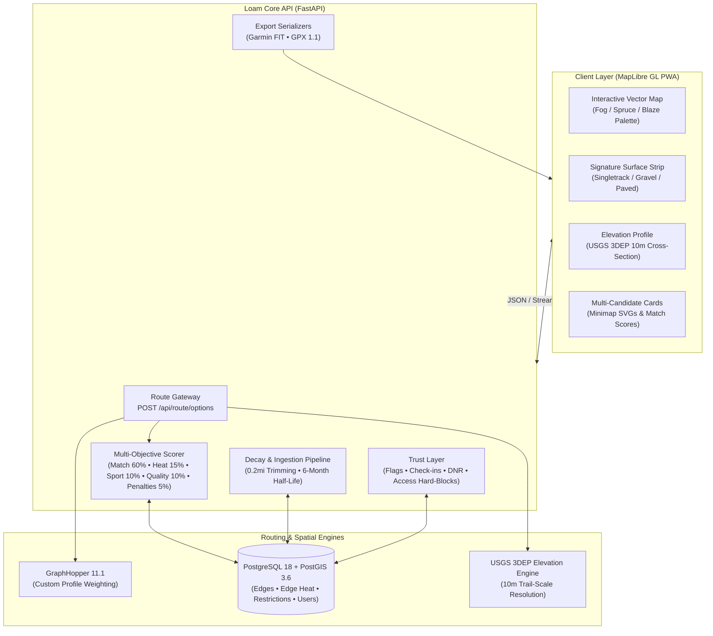

# Loam — Trail Route Builder

<p align="center">
  
</p>

<p align="center">
  <strong>An intelligent, privacy-first route builder for mountain biking and trail running.</strong><br>
  Down-weights overgrown ghost trails with a 12-month recency heat decay, offers up to 10 distinct candidates that follow real OSM trails, and exports Garmin GPX/FIT.
</p>

<p align="center">
  
  
  
  
  
  
</p>

---

## The Vision

Popular routing tools fail trail athletes in predictable ways:
- **Global heatmaps remember dead trails forever**: Strava aggregates ten years of GPS data, sending riders down washed-out logging roads, overgrown briar patches, and decommissioned trails that haven't been rideable since 2017.
- **Road routers don't understand trail textures**: Traditional navigation apps treat singletrack, fire roads, and asphalt as interchangeable lines on a map, resulting in boring pavement connectors or impassable boulder fields.
- **Lack of variety**: Most engines produce a single "optimal" line rather than a rich palette of distinct loop options tailored to target distance and terrain appetite.

**Loam solves this from first principles:**
1. **Dynamic Recency Decay**: Heat isn't eternal. A 12-month rolling window with an exponential 6-month half-life rewards actively ridden trails and systematically penalizes neglected ghost trails.
2. **Terrain-Mix Control & Signature Surface Strip**: Dial in your preferred blend of singletrack, doubletrack, gravel, and pavement. Every candidate route renders with an interactive, color-coded **Surface Strip** synchronized with an elevation profile sampled from USGS 3DEP (about 10 m) tiles. Where no tile covers a route, elevation shows as unavailable, never estimated.
3. **Multi-Candidate Ranking Engine**: Generates up to 10 structurally distinct candidate routes (fewer when the trail network only supports fewer honest ones), evaluated with a multi-objective scoring formula and out-and-back repetition penalties.
4. **Community Trust Layer**: One-tap rider check-ins ("still open & clear"), community caution flags (downed trees, seasonal mud, washouts), and strict DNR/closure enforcement protect riders and sensitive terrain.
5. **Privacy by Design**: Mandatory 3+ rider anonymity thresholds before heat is shared, automatic 0.2-mile start/finish trimming, customizable privacy exclusion zones, and instant account erasure.
6. **Frictionless Hardware Sync**: Direct one-click download of GPX 1.1 and native binary Garmin FIT course files compatible with Garmin fenix 7 Pro and Edge cycling computers.

---

## Architecture Overview



---

## Key Features

### 1. Signature Surface Strip & Terrain Slider
Rather than treating a route as an opaque polyline, Loam breaks every meter into categorized surface segments:
- 🟢 **Singletrack**: Technical dirt, bench-cut trails, and flow paths.
- 🟡 **Doubletrack / Two-track**: Old woods roads, forest access roads, and snowmobile paths.
- 🟤 **Gravel**: Graded unpaved public rights of way.
- ⚪ **Paved**: Asphalt and chip-seal (minimized by default for trail profiles).

The synchronized **Surface Strip** allows athletes to inspect exactly where technical trail begins and ends relative to climbs, descents, and parking areas.

### 2. Multi-Candidate Route Engine & Scoring
Loam formulates route generation as a multi-candidate exploration problem. For any trailhead or target distance:
- Builds candidates from three sources through one route builder: a loop search over the real OSM trail graph, GraphHopper corridors in divergent sectors, and loops other riders actually rode (seeds).
- Every candidate passes a geometry gate: the line must stay within 15 m of the OSM ways it claims. Routes that fail are never shown.
- Deduplicates geometry and applies an **out-and-back repetition penalty** to minimize redundant backtrack segments.
- Scores candidates against five weighted dimensions:
  $$\text{Score} = 0.60 \cdot S_{\text{input}} + 0.15 \cdot S_{\text{heat}} + 0.10 \cdot S_{\text{mode}} + 0.10 \cdot S_{\text{quality}} - S_{\text{penalties}}$$
- Outputs up to 10 ranked options (with a notice when fewer qualify) with vector minimaps, elevation gain/loss, and surface percentage breakdowns.

### 3. Recency Heat Decay & Ghost Trail Suppression
- **Exponential Time Decay**: Recorded rides degrade smoothly over time using $e^{-\lambda \Delta t}$ with a 180-day half-life.
- **Coverage-Aware Penalty**: Trails with zero heat in well-mapped trail networks are heavily deprioritized. In remote, unmapped areas, heat remains neutral to prevent false penalties.
- **Benchmark**: `loam_eval real` scores routes from real OSM trailhead starts across New Hampshire against OSM itself (gate pass rate, off-network share, true loops). The latest report is `benchmark/reports/round7.md`.

### 4. Community Trust Layer & Land Ethics
- **One-Tap Rider Check-Ins**: Riders confirm trail status ("still open & clear") with confidence scores refreshed upon each report.
- **Community Caution Flags**: Warns fellow athletes of downed trees, muddy ruts, washouts, and active trail work with abuse-resistant, verified voting.
- **Strict Access Controls**: Hard blocks on `access=private/no`, `bicycle=no`, wilderness areas, and wildlife sanctuaries. Seasonal warnings for shared snowmobile trail permissions.
- **Personal DNR List**: Athletes can mark trails as "Do Not Route" (soft warning with override log, or hard block).

### 5. "Find New Trails" Novelty Engine
Exploration mode rewards routes containing trail segments the athlete has **never ridden before**, using a discovery novelty boost to expand personal riding horizons while ensuring selected paths have verified community heat.

### 6. Ironclad Privacy & Data Sovereignty
- **3+ Rider Minimum Anonymity Threshold**: A trail segment's heat is never broadcast or used in other users' routing unless at least 3 distinct riders have ridden it.
- **Start/Finish Buffer Trimming**: Automatically removes the first and last 0.2 miles (320 meters) of all uploaded GPX/FIT rides to prevent revealing homes or trailheads.
- **Privacy Zones**: Custom exclusion zones (e.g. home, work) where activity coordinates are stripped prior to map-matching.
- **Right to Erasure**: Complete, one-click account deletion and comprehensive personal data export (`GET /api/privacy/export`).

---

## User Interface Design (Section 18 Guidelines)

Loam is built from the ground up to adhere to high-standard outdoor design tokens:

| Token | Hex | Role |
| :--- | :--- | :--- |
| **Fog** | `#E7ECEC` | Clean, low-glare outdoor canvas background |
| **Spruce** | `#1D3B34` | Primary brand deep evergreen tone for panels and text |
| **Blaze** | `#FF5B14` | High-contrast trail marker orange for active route lines and CTAs |
| **Lichen** | `#A9BF7A` | Secondary muted accent for singletrack surfaces and badges |
| **Slate** | `#3F6C8F` | Info and secondary route options |

- **Phone-First, Map-First**: Responsive Progressive Web App: a service worker precaches the app shell and the last 10 routes you viewed stay available offline. Map tiles and live routing need a connection.
- **Imperial by Default**: All distances, climbs, and paces display in miles and feet.

---

## Quickstart & Local Setup

### Prerequisites
- [Docker](https://www.docker.com/) & Docker Compose
- Python 3.12+ (or Python 3.14)
- Node.js 20+ & npm

### Option A: Complete Stack via Docker Compose
Start GraphHopper (with New Hampshire graph extract), PostGIS 18 (with spatial schema), and the Loam API in containers:

```bash
# Clone the repository
git clone https://github.com/JJRPF/loam.git
cd loam

# Launch all services
docker compose up -d

# Verify system health
curl http://localhost:8080/health
```

### Option B: Local Python Development
```bash
# 1. Activate Python virtual environment
source .venv/bin/activate

# 2. Install backend dependencies
pip install -r requirements.txt

# 3. Build frontend PWA assets
cd frontend && npm install && npm run build && cd ..

# 4. Start Loam FastAPI server
PYTHONPATH=. python -m uvicorn app.main:app --host 0.0.0.0 --port 8080 --reload
```

---

## Data setup (once per machine)

Data lives under `DATA_DIR` (default `data/` in the main clone) and is never committed.

```bash
# 1. Database tables
PYTHONPATH=. python -m scripts.migrate

# 2. Elevation: USGS 3DEP 1/3 arc-second tiles for New Hampshire (about 4 GB)
python -I scripts/fetch_3dep.py

# 3. OSM trail graph into PostGIS (reads the same extract GraphHopper uses, so way ids match)
PYTHONPATH=. python -m scripts.import_osm_graph

# 4. Optional: your own Garmin export as real heat and loop seeds (runs only on your machine)
python3 -I scripts/strip_garmin_export.py --export ~/Downloads/<garmin-export> --out $DATA_DIR/garmin-stripped/
PYTHONPATH=. python -m scripts.upload_stripped --dir $DATA_DIR/garmin-stripped --url https://<host> --token-file ~/token   # admin Firebase ID token
```

The strip step keeps only (lat, lon, time), trims 0.2 mi from both ends and drops your privacy zones. The export itself is never uploaded or committed. `upload_stripped --direct --user-id <uid>` imports into the local database without HTTP.

## Firebase sign-in setup

Sign-in is Firebase Auth (Google and email link). The API only trusts verified ID tokens.

1. In the Firebase console for the project, add a **Web app** and copy its config into `.env` as `VITE_FIREBASE_API_KEY`, `VITE_FIREBASE_AUTH_DOMAIN`, `VITE_FIREBASE_PROJECT_ID`, `VITE_FIREBASE_APP_ID`. These are read at **build** time, so rebuild the frontend afterwards.
2. Authentication → Sign-in method: enable **Google** and **Email link (passwordless)**.
3. Authentication → Settings → Authorized domains: add the app's domain (and `localhost` for development). Nothing else.
4. Set `FIREBASE_PROJECT_ID`, `ADMIN_EMAILS` (verified emails that get admin) and `CORS_ORIGINS` (the app origin and `http://localhost:5173`) in the API's `.env`, and `LOAM_ENV=production` on the Pi.

## Bad-route reports

Set `GITHUB_FEEDBACK_TOKEN` (a fine-grained token limited to this repository with Issues read/write). Reports are stored in full on the server; the GitHub issue gets the comment, route settings without coordinates, and the route line with the first and last 0.5 mi removed. If GitHub is unreachable, the nightly worker files pending reports.

## Pre-launch checklist

- [ ] `HEAT_MIN_UNIQUE_RIDERS` is unset (default **3**) on the Pi. The creator's imported rides are public as seed heat on trail-class edges only (`SEED_HEAT_PUBLIC`, default true).
- [ ] Strava and Trailforks connectors stay off until their current terms are confirmed.
- [ ] Terms of service and privacy policy are in place; the repository's code becomes public, so re-read what issue reports include.
- [ ] A known ghost-trail and good-trail list for an area you know is run through the benchmark.

---

## Running the Test Suite

The suite runs against a real PostGIS database and GraphHopper; run `pytest -q` for the current count.

```bash
# Needs the local PostGIS and GraphHopper containers (docker compose up -d)
PYTHONPATH=. pytest -q
```

### Test Coverage Highlights:
- `tests/test_api.py`: Baseline point-to-point routing, surface classification, and PostGIS heat recording.
- `tests/test_stage2_mvp.py`: Loop mode, sport profiles, saved routes CRUD, Garmin FIT & GPX export, and PWA static serving.
- `tests/test_stage3_options.py`: Multi-candidate generation, repetition penalties, minimap SVG generator, and streaming API.
- `tests/test_stage4_heat.py`: GPX/FIT defensive parsing (XXE immunity, size limits), 0.2 mi trimming, privacy zones, recency decay formula, and 3-rider threshold.
- `tests/test_stage5_trust.py`: Community flags, rider check-ins, user DNR overrides, land manager restrictions, and account deletion.
- `tests/test_stage6_differentiators.py`: "Find New Trails" discovery mode, trail submissions, trail running profile, and decoupled connectors.
- `tests/test_e2e_acceptance.py`: Unified full lifecycle test traversing all 6 stages sequentially.
- `tests/test_round7_*.py`: Firebase token verification, no fabricated data, OSM import and surface classes, 3DEP elevation, routing and the geometry gate, Garmin export heat and seeds, bad-route reports.

---

## API Reference Highlights

| Method | Endpoint | Description |
| :--- | :--- | :--- |
| `GET` | `/health` | System health check (GraphHopper, PostGIS, elevation engine). |
| `POST` | `/api/route/options` | Generate and rank up to 10 candidate routes for a given trailhead and distance. |
| `POST` | `/api/route/options/stream` | Server-Sent Events (SSE) streaming candidate routes in real-time. |
| `POST` | `/api/reports/bad-route` | Signed-in riders report a bad route; it becomes a GitHub issue (route line trimmed 0.5 mi each end). |
| `GET` | `/api/heat/meta` | The heat privacy threshold in force and whether the seed-data notice applies. |
| `POST` | `/api/export/fit` | Export route as Garmin binary FIT Course (fenix 7 Pro & Edge compatible). |
| `POST` | `/api/export/gpx` | Export route as standardized GPX 1.1 track. |
| `POST` | `/api/activities/upload` | Ingest GPX/FIT ride with automatic 0.2-mile privacy buffer trimming. |
| `POST` | `/api/trails/{edge_osm_id}/checkin` | Submit one-tap rider check-in ("still open & clear"). |
| `POST` | `/api/flags` | Report trail hazard (downed tree, muddy, washed out, overgrown). |
| `GET` | `/api/trails/new-to-me` | Discover unridden trail segments with verified community heat. |
| `GET` | `/api/connectors` | Check third-party connector statuses (Strava, Garmin, Trailforks). |
| `DELETE`| `/api/privacy/account` | Permanently erase user account, routes, and personal GPS history. |

---

## Open Source & Data Attribution

- **Base Map Data**: [© OpenStreetMap contributors](https://www.openstreetmap.org/copyright), licensed under the Open Database License (ODbL).
- **Elevation**: USGS 3D Elevation Program (3DEP) high-resolution 1/3 arc-second bare-earth DEM.
- **Routing Engine**: Powered by [GraphHopper](https://www.graphhopper.com/).