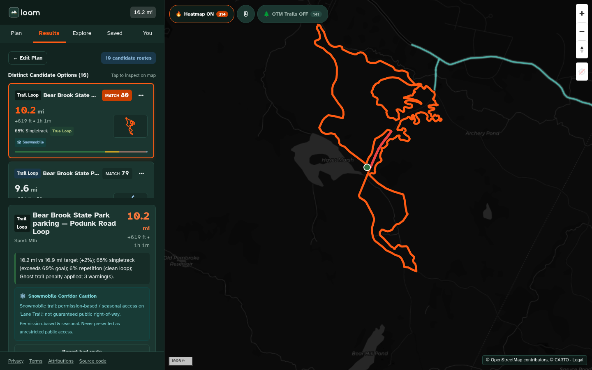
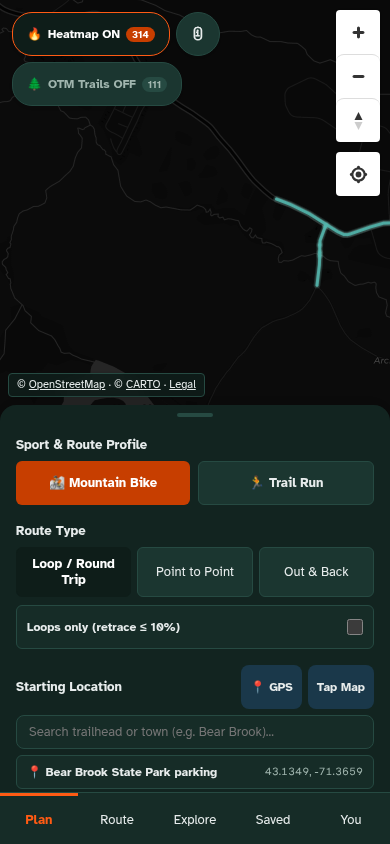
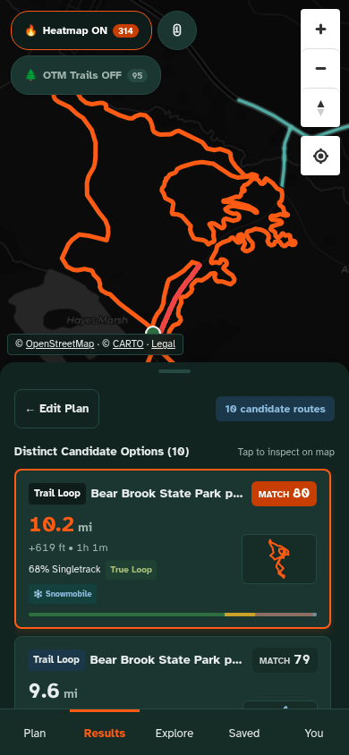
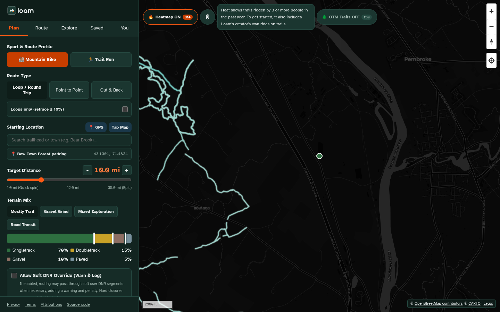
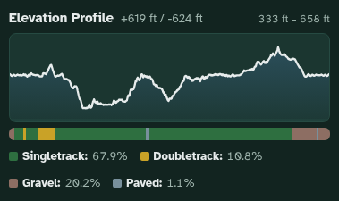
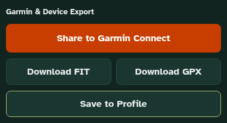
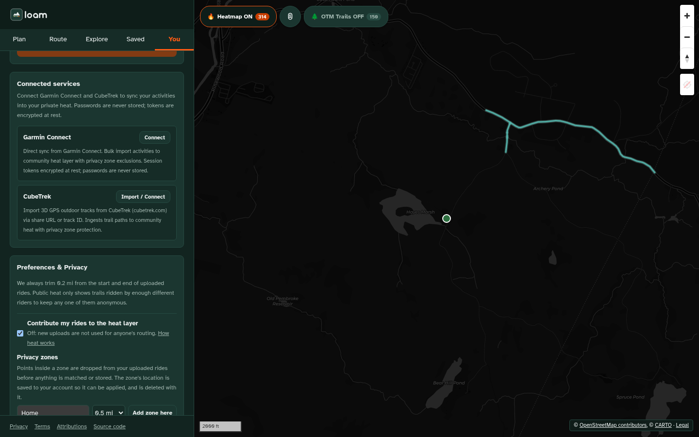
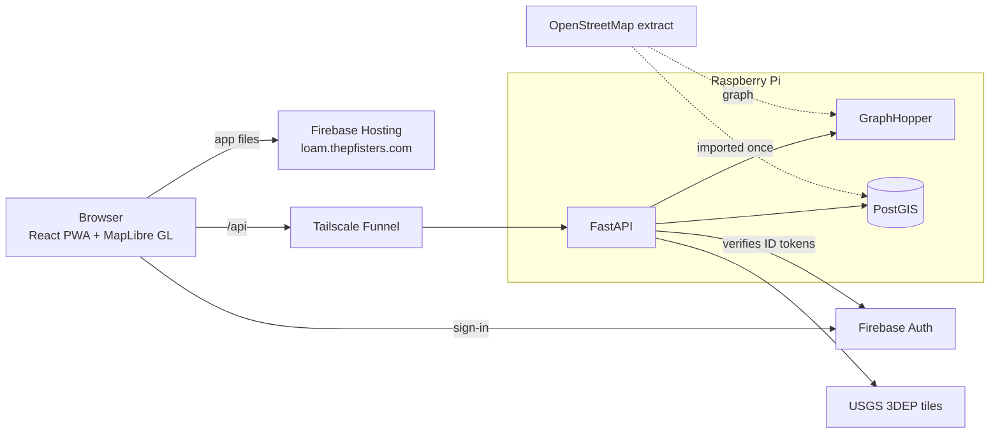

<p align="center">
  <picture>
    <source media="(prefers-color-scheme: dark)" srcset="frontend/public/brand/png/loam-logo-horizontal-reversed.png">
    
  </picture>
</p>

<h3 align="center">Find the loop. Skip the ghost trails.</h3>

<p align="center">
  A free route builder for mountain biking and trail running. It builds loops on real trails, shows the surface and the climb before you leave, and sends the route to your Garmin.<br>
  <strong>Try it at <a href="https://loam.thepfisters.com">loam.thepfisters.com</a></strong>
</p>

<p align="center">
  <a href="LICENSE"></a>
  <a href="https://loam.thepfisters.com"></a>
  
  
  
  
</p>

<p align="center">
  
</p>

<table align="center">
  <tr>
    <td align="center"><br><sub>Plan</sub></td>
    <td align="center"><br><sub>Results</sub></td>
    <td align="center"><br><sub>Trail heat</sub></td>
  </tr>
</table>

_Screenshots are real app output at Bear Brook State Park, Allenstown, NH (the heat shot is at Bow Town Forest, where there is more public heat to see)._

## Why Loam

- **Loops that follow real trails.** Routes are built on the OpenStreetMap trail network, and a candidate is dropped if its line strays more than 15 m from the ways it claims.
- **Heat that forgets.** Heat counts rides from the last 12 months and halves every 6, so a trail nobody has ridden in years stops looking popular.
- **The surface and the climb, up front.** Every candidate has a surface strip (singletrack, doubletrack, gravel, paved) beside an elevation profile from USGS 3DEP. Where no elevation data exists, it says so instead of guessing.
- **Private by default.** Trail heat is public only when three or more riders have ridden a trail. Uploaded rides lose their first and last 0.2 mi.
- **Garmin export.** Download a GPX track or a FIT course.

## Features

### Plan a route
Pick mountain bike or trail run, a loop, point to point or out and back, a distance and a terrain mix (a stacked bar with draggable dividers). Search a trailhead or town, tap the map, or use your location. Every search is a link: the address bar always holds the search, so you can share it.

<p align="center">
  
</p>

### Compare candidates
Loam builds up to 10 distinct candidates and ranks them. It shows fewer, with a note, when the trail network supports fewer honest ones. Each card has a minimap, distance, climb, surface split and a match score. The score is 60% how well it fits your request, 15% heat, 10% how well it fits the route type, 10% route quality, minus penalties for retracing and for do-not-route trails.

### Export
<p align="center">
  
</p>

Download a GPX 1.1 track or a Garmin FIT course. Signed-in riders can save routes; the last 10 routes you looked at stay available offline (the app is an installable PWA; map tiles and new routes need a connection).

### Trail heat
The heat layer shows trails that three or more people rode in the past year. To get the map started, it also includes the creator's own rides, on trails only (never roads); the app says so next to the layer.

### Trust and access
Signed-in riders can keep a personal do-not-route list and report a bad route. Community hazard flags show as warnings on a route; the API takes flags, votes and "still open" check-ins, but the app has no buttons for them yet. Ways that are private, closed to bikes or inside a Wilderness area are never routed. Shared snowmobile corridors carry a seasonal caution.

### You
<p align="center">
  
</p>

Sign in with Google or an emailed link (no passwords). Upload GPX or FIT rides to add to heat, with the first and last 0.2 mi removed, privacy zones around places you want left out, an off switch for contributing, a full data export and one-tap account deletion.

## Privacy

- Heat from other riders is public only for trails with at least 3 distinct riders (`HEAT_MIN_UNIQUE_RIDERS`, default 3). Below that, you see only your own rides.
- The creator's imported rides are public as "seed" heat on trail-class ways only (`SEED_HEAT_PUBLIC`).
- Uploaded rides are trimmed 0.2 mi at both ends and cleared of your privacy zones before anything is matched or stored.
- Bad-route reports become public GitHub issues. They hold your comment, your route settings and the route line minus 0.5 mi at each end, never your start or end point.
- You can export or delete everything we hold about you from the You panel.

The details are in the [privacy policy](frontend/public/legal/privacy/index.html), the [terms](frontend/public/legal/terms/index.html) and [attributions](frontend/public/legal/attributions/index.html) (served at `/legal/` on the live site).

## How it works



The web app is static files on Firebase Hosting. The API runs on a Raspberry Pi, reached through a Tailscale Funnel, with PostGIS for trails and heat and GraphHopper for routing. The API trusts only verified Firebase ID tokens.

## Self-hosting quickstart

You need Docker with Compose, Python 3.12+ and Node 20+.

```bash
git clone https://github.com/JJRPF/loam.git && cd loam
cp .env.example .env            # edit: DATA_DIR, DATABASE_URL (use localhost outside compose), Firebase values

docker compose up -d postgis
python -m venv .venv && . .venv/bin/activate && pip install -r requirements.txt
```

Data lives under `DATA_DIR` and is never committed:

```bash
# 1. Database tables
PYTHONPATH=. python -m scripts.migrate

# 2. Elevation: USGS 3DEP 1/3 arc-second tiles for New Hampshire (about 4 GB)
python -I scripts/fetch_3dep.py

# 3. OSM trail graph into PostGIS (reads the same extract GraphHopper uses, so way ids match)
PYTHONPATH=. python -m scripts.import_osm_graph
```

GraphHopper reads `$DATA_DIR/graphhopper/config.yml` (start from [docs/graphhopper-config.example.yml](docs/graphhopper-config.example.yml)) and the OSM extract at `$DATA_DIR/osm/new-hampshire-latest.osm.pbf` (from [Geofabrik](https://download.geofabrik.de/north-america/us/new-hampshire.html)). Put `graphhopper-web-11.1.jar` from the [GraphHopper releases](https://github.com/graphhopper/graphhopper/releases) in `$DATA_DIR/graphhopper/`, then start it with `docker compose up -d graphhopper` (the first start builds the graph and takes several minutes). Then build the web app and run the API:

```bash
python scripts/build_trailheads.py "$DATA_DIR/osm/new-hampshire-latest.osm.pbf"   # trailhead search data
cd frontend && npm ci && npm run build && cd ..
PYTHONPATH=. python -m uvicorn app.main:app --host 127.0.0.1 --port 8080
curl http://127.0.0.1:8080/health
```

The API serves `frontend/dist`, so http://127.0.0.1:8080 is the whole app. For frontend work, `npm run dev` in `frontend/` serves on :5173 and proxies `/api` to :8080.

Sign-in needs your own Firebase project:

1. Add a Web app and put its `apiKey`, `appId` and `projectId` in `.env` as `VITE_FIREBASE_API_KEY`, `VITE_FIREBASE_APP_ID`, `VITE_FIREBASE_PROJECT_ID`, then rebuild (they are read at build time). Without them the app routes anonymously and the sign-in card says sign-in isn't configured.
2. Authentication > Sign-in method: enable Google and Email link.
3. Authentication > Settings > Authorized domains: add the app's domain.
4. The production build uses the app's own domain as `authDomain` (`VITE_FIREBASE_AUTH_DOMAIN`, set in `scripts/web-build-env.sh`), so Firebase Hosting serves the sign-in handler at `/__/auth/handler`. For Google sign-in, add `https://<your domain>/__/auth/handler` as an authorized redirect URI on the project's web OAuth client (Google Cloud console > APIs & Services > Credentials), and allow the domain as an authorized JavaScript origin. Changes there can take a few minutes to apply. Email link needs none of this.
5. If you add a service worker or rewrite rules of your own, leave `/__/` alone: it belongs to Firebase.

Optional, your own Garmin export as heat and loop seeds (runs only on your machine; the export is never uploaded or committed):

```bash
python3 -I scripts/strip_garmin_export.py --export ~/Downloads/<garmin-export> --out $DATA_DIR/garmin-stripped/
PYTHONPATH=. python -m scripts.upload_stripped --dir $DATA_DIR/garmin-stripped --direct --user-id <uid>
```

### Configuration

| Variable | Default | What it does |
| :--- | :--- | :--- |
| `APP_ENV` (or `LOAM_ENV`) | `development` | `production` turns on the production checks (a real `CONNECTOR_SECRET_KEY`, no auth emulator). |
| `DATABASE_URL`, `GRAPHHOPPER_URL`, `DATA_DIR` | see `.env.example` | Where the services and data are. |
| `FIREBASE_PROJECT_ID` | `thepfisters` | The project whose ID tokens the API accepts. |
| `ADMIN_EMAILS` | none | Verified emails with admin access. |
| `CORS_ORIGINS` | the app, the API host, `localhost:5173` | Browser origins allowed to call the API. |
| `PUBLIC_APP_ORIGIN`, `API_PUBLIC_HOST` | unset | When set, GET navigations on the API's public host redirect to the web app. |
| `HEAT_MIN_UNIQUE_RIDERS` | `3` | Riders needed before a trail's heat is public. |
| `SEED_HEAT_PUBLIC` | `true` | Whether the creator's seed heat is public, on trail-class ways only. |
| `ENABLE_MIDPOINTS` | `false` | Midpoint (via point) routing, off while it is reworked. |
| `ENABLE_STRAVA_CONNECTOR`, `ENABLE_TRAILFORKS_CONNECTOR` | `false` | Connectors stay off until their terms are confirmed. Disabled connectors are not shown. |
| `ENABLE_GARMIN_LOGIN_CONNECTOR`, `ENABLE_CUBETREK_CONNECTOR` | `true` | Ride import connectors. |
| `CONNECTOR_SECRET_KEY` | in-code dev key | Encrypts connector credentials. Required in production. |
| `GITHUB_FEEDBACK_TOKEN`, `GITHUB_FEEDBACK_REPO` | none, `JJRPF/loam` | Bad-route reports file issues with this fine-grained token. |
| `RATE_LIMIT_ROUTE`, `_GEOCODE`, `_UPLOAD`, `_FLAG` | `20/600`, `60/60`, `30/3600`, `60/3600` | Requests per window in seconds. |
| `ROUTE_CONCURRENCY`, `ROUTE_WAIT_S` | `2`, `20` | Routes built at once, and how long a request waits for a slot. |
| `VITE_API_BASE` | empty | Build time: the API's origin (empty uses the Vite proxy). |
| `VITE_PUBLIC_APP_ORIGIN` | unset | Build time: an app opened on another origin redirects here. |
| `VITE_FIREBASE_API_KEY`, `_AUTH_DOMAIN`, `_PROJECT_ID`, `_APP_ID` | none | Build time: the Firebase web app config. |

## Development and tests

```bash
docker compose up -d postgis graphhopper
PYTHONPATH=. pytest -q                       # API tests against real PostGIS and GraphHopper
cd frontend && npm run lint && npm run build # type check and production build
npm run test:browser                         # Playwright suite, below
```

The browser suite (`tests/browser/`, Playwright with system Chromium) builds the production bundle and runs it the way production is wired: static files from a stand-in for Firebase Hosting (with the real `firebase.json` headers, CSP included), the API on another origin with the dev database, and the Firebase Auth emulator for signed-in flows. It checks layout at six viewports (no overlaps, no sideways scroll, 44 px touch targets), accessibility with axe, console, network and CSP errors, a full route build with GPX and FIT downloads, legal pages, rate-limit messages, and the old-origin redirect. It never talks to production; `tests/browser/smoke.prod.spec.ts` is a separate read-only check you run by hand. The emulator needs `npx` and no Google account. To retake the README screenshots: `SHOTS=1 npm run test:browser -- screenshots`, then `python scripts/optimize_screenshots.py`.

## Deploying

The API runs on a Raspberry Pi; the web app on Firebase Hosting. Deploys are automatic:

- a pull request from the owner is deployed to **staging** (https://loamstaging.thepfisters.com, with its own API and database, test data only) and the link is commented on the PR;
- a merge to `main` deploys **production**: the API (database backup, migrations, health check, automatic rollback), then Hosting, then a smoke check. *Actions → Production → Run workflow* redeploys or rolls back to any commit on `main`.

How it works, what staging may and may not hold, the one-time owner steps (Pi, Tailscale, Firebase, GCP, GitHub) and the limits are in [DEPLOYMENT.md](DEPLOYMENT.md). `scripts/deploy-web.sh` (`HOSTING_TARGET=prod|staging`) remains for a manual Hosting deploy; it deploys hosting only (the Firebase project is shared, so nothing else is ever deployed). Back up the database (`scripts/backup_db.sh`) before any manual migration. The pre-launch list is in [docs/launch-checklist.md](docs/launch-checklist.md).

## Data and attribution

Map data © [OpenStreetMap contributors](https://www.openstreetmap.org/copyright) (ODbL), map tiles © [CARTO](https://carto.com/attributions), elevation from the [USGS 3D Elevation Program](https://www.usgs.gov/3d-elevation-program), forecasts from the National Weather Service. Full list and third-party licenses: [attributions](frontend/public/legal/attributions/index.html).

## License

[GNU AGPL v3 or later](LICENSE). If you run a modified Loam as a service, your users get your source. Questions and bug reports: [GitHub issues](https://github.com/JJRPF/loam/issues).
