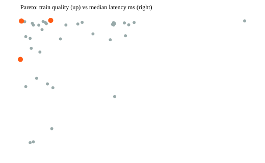

# Round 1 tuning report

## Summary

40 variants (LHS warm start -> TPE, seed 30) scored on 49 train scenarios; top 4 validated on 16. Best: trial 29 (val objective 54.2404). The holdout was not used.

## Baseline vs best (same scenarios)

| config | mean score | gate pass | road cap met | fake lollipop | mean q1 | infeasible | median ms |
|---|---|---|---|---|---|---|---|
| baseline (Round 4 approx) train | 41.2044 | 43.2% | 89.7% | 8.9% | 33.778 | 5 | 94.73 |
| default v1 train | 61.5355 | 75.0% | 99.3% | 0.0% | 58.761 | 5 | 32.24 |
| best train | 67.703 | 81.8% | 100.0% | 0.0% | 64.43 | 5 | 33.59 |
| baseline val | 37.9042 | 46.2% | 81.2% | 9.1% | 29.943 | 3 | 241.85 |
| best val | 54.2404 | 69.2% | 100.0% | 0.0% | 49.546 | 3 | 52.06 |

Best config: `benchmark/configs/best_v1.json` (trial 29, seed 30, result hash train `81183906492bdf22`).

## Failure clusters (best config, train)

| gate failure on top-1 | scenarios | ids |
|---|---|---|
| ghost_trail | 8 | s024, s025, s031, s035, s041, s059, s067, s070 |
| infeasible (no candidate passes Layer 0) | 5 | s015, s027, s034, s051, s055 |

## Pareto front (quality vs latency)

| trial | kind | train mean score | median ms |
|---|---|---|---|
| 29 | tpe | 67.703 | 32.56 |
| 36 | tpe | 67.6483 | 32.29 |
| 4 | lhs | 64.5479 | 32.28 |

Latency is wall-clock of the ranking pipeline only and varies run to run; it is excluded from the reproducibility hash. Real GraphHopper latency needs a live run.

## Layer 2 / Layer 3

Layer 2: no human labels collected yet (generate a sheet with `loam-eval label-sheet`). Layer 3: not run. There is no approved spend and no labels to calibrate against, so the judge would be advisory only. Safeguards are in loam_eval/judge.py.

## Sample of winning routes (review by eye)

- s052: loop, 8.81 mi, true retrace 0%, road 12% -> s052_top1.svg
- r4_road_cap: loop, 13.6 mi, true retrace 0%, road 0% -> r4_road_cap_top1.svg
- s003: loop, 9.64 mi, true retrace 1%, road 0% -> s003_top1.svg
- s079: point_to_point, 6.35 mi, true retrace 0%, road 0% -> s079_top1.svg
- s053: loop, 3.4 mi, true retrace 0%, road 0% -> s053_top1.svg
- s029: loop, 9.36 mi, true retrace 0%, road 0% -> s029_top1.svg

## Notes and caveats

- Benchmark candidates are synthetic and frozen (loam_eval/synth.py), pushed through the real process_graphhopper_path + select_options. Cost-model and waypoint-snapping parameters ([live] in EngineConfig) are NOT exercised offline and were not tuned.
- 'baseline_round4.json' approximates Round 4 behaviour through config flags; it is not the old code.
- Retrace uses the engine's convention (distance covered a second time / total): a pure out-and-back is 0.50.
- DNR hard-blocks come from the DB-backed trust layer and are not simulated; the Layer-0 gate exists but never fires here.
