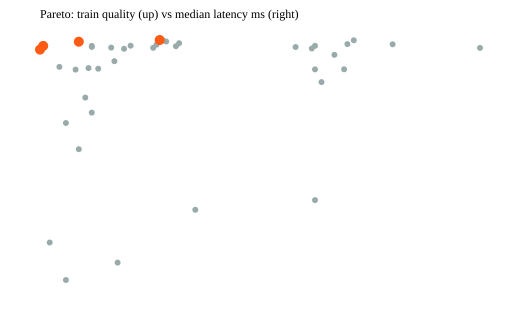

# Round 2 tuning report

## Summary

40 variants (LHS warm start -> TPE, seed 30) scored on 49 train scenarios; top 4 validated on 16. Best: trial 24 (val objective 62.0229). The holdout was not used.

## Baseline vs best (same scenarios)

| config | mean score | gate pass | road cap met | fake lollipop | mean q1 | infeasible | median ms |
|---|---|---|---|---|---|---|---|
| baseline (Round 4 approx) train | 50.0439 | 56.8% | 79.2% | 6.8% | 43.738 | 5 | 94.33 |
| default v1 train | 69.2305 | 86.4% | 98.5% | 0.0% | 66.448 | 5 | 32.63 |
| best train | 78.3243 | 97.7% | 100.0% | 0.0% | 76.162 | 5 | 34.04 |
| baseline val | 39.4828 | 46.2% | 70.8% | 6.9% | 29.943 | 3 | 241.87 |
| best val | 62.0229 | 84.6% | 100.0% | 0.0% | 58.043 | 3 | 52.47 |

Best config: `benchmark/configs/best_v2.json` (trial 24, seed 30, result hash train `755ce6ccfdbb0e65`).

## Failure clusters (best config, train)

| gate failure on top-1 | scenarios | ids |
|---|---|---|
| infeasible (no candidate passes Layer 0) | 5 | s015, s027, s034, s051, s055 |
| ghost_trail | 1 | s031 |

## Pareto front (quality vs latency)

| trial | kind | train mean score | median ms |
|---|---|---|---|
| 39 | tpe | 78.4132 | 32.92 |
| 36 | tpe | 78.3134 | 32.67 |
| 32 | tpe | 78.0739 | 32.56 |
| 22 | tpe | 77.8624 | 32.55 |

Latency is wall-clock of the ranking pipeline only and varies run to run; it is excluded from the reproducibility hash. Real GraphHopper latency needs a live run.

## Layer 2 / Layer 3

Layer 2: no human labels collected yet (generate a sheet with `loam-eval label-sheet`). Layer 3: not run. There is no approved spend and no labels to calibrate against, so the judge would be advisory only. Safeguards are in loam_eval/judge.py.

## Sample of winning routes (review by eye)

- s052: out_and_back, 8.13 mi, true retrace 32%, road 13% -> s052_top1.svg
- r4_road_cap: loop, 13.6 mi, true retrace 0%, road 0% -> r4_road_cap_top1.svg
- s003: lollipop, 10.38 mi, true retrace 14%, road 11% -> s003_top1.svg
- s079: point_to_point, 6.35 mi, true retrace 0%, road 0% -> s079_top1.svg
- s053: loop, 3.4 mi, true retrace 0%, road 0% -> s053_top1.svg
- s029: loop, 10.29 mi, true retrace 0%, road 0% -> s029_top1.svg

## Notes and caveats

- Benchmark candidates are synthetic and frozen (loam_eval/synth.py), pushed through the real process_graphhopper_path + select_options. Cost-model and waypoint-snapping parameters ([live] in EngineConfig) are NOT exercised offline and were not tuned.
- 'baseline_round4.json' approximates Round 4 behaviour through config flags; it is not the old code.
- Retrace uses the engine's convention (distance covered a second time / total): a pure out-and-back is 0.50.
- DNR hard-blocks come from the DB-backed trust layer and are not simulated; the Layer-0 gate exists but never fires here.
